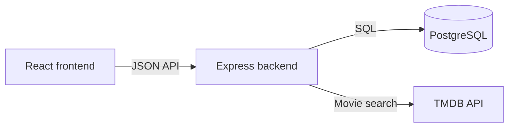

<div align="center">
  
  <h1>MovieMate</h1>
  <p><strong>Your movie journal, shared with friends.</strong></p>
  <p>Track what you watch, write reviews, keep a watchlist, and see what your friends think.</p>
  <p>
    
    
    
    
    
  </p>
</div>

MovieMate is a movie journal and small social space for movie fans. Keep a
personal record of what you have watched, rate and review films, save titles
for later, and share your movie activity with friends.

## Live demo

[Open MovieMate](https://movie-mate-self-rho.vercel.app/login)

## What you can do

| Capability | Description |
| --- | --- |
| Discover movies | Search movie information provided by TMDB. |
| Keep a movie journal | Record watched movies, ratings, tags, and personal notes. |
| Plan what to watch | Save movies to a personal watchlist. |
| Share with friends | Find users, manage friend requests, and browse friends' profiles and reviews. |
| Stay up to date | Receive notifications about friend activity and review mentions. |
| Personalize your account | Manage your profile, privacy preferences, and account settings. |

The interface is responsive and designed for both mobile and desktop screens.

## Architecture



## Technology

| Layer | Technologies |
| --- | --- |
| Frontend | React 18, React Router, Vite 5 |
| Backend | Node.js 18+, Express 4 |
| Database | PostgreSQL |
| Movie catalogue | TMDB API |

## Repository structure

```text
MovieMate/
├── Frontend/                         React + Vite web app
│   ├── public/                       Static assets and app logo
│   ├── src/
│   │   ├── components/               Shared UI components
│   │   ├── pages/                    Route-level screens
│   │   ├── api.js                    Backend API client
│   │   ├── App.jsx                   Application routes
│   │   └── store.jsx                 Shared client state
│   ├── .env.example                  Frontend environment template
│   ├── vercel.json                   SPA route rewrites
│   └── vite.config.js                Vite config and local API proxy
├── backend/                          Express + PostgreSQL API
│   ├── migrations/                  Ordered database schema migrations
│   ├── src/
│   │   ├── routes/                   API route handlers
│   │   ├── db.js                     PostgreSQL connection pool
│   │   ├── migrate.js                Migration runner
│   │   └── server.js                 API server and middleware
│   └── .env.example                  Backend environment template
├── .gitignore                        Secret and generated-file exclusions
├── DEPLOYMENT.md                     Hosting and release checklist
└── README.md                         Project overview and setup guide
```

## Run locally

### Prerequisites

- Node.js 18 or newer
- PostgreSQL (local or hosted)
- A TMDB API key

### 1. Install and configure the backend

From the repository root, open PowerShell:

```powershell
cd backend
Copy-Item .env.example .env
npm ci
```

Edit `backend/.env` and provide `DATABASE_URL`, `JWT_SECRET`, and
`TMDB_API_KEY`. For a hosted database that requires TLS, set `DB_SSL=true`;
certificate verification remains enabled. Keep `.env` private and never commit
it.

Run the database migrations and start the API:

```powershell
npm run migrate
npm run dev
```

The API listens at `http://localhost:5000`. Its health endpoint is
[`http://localhost:5000/api/health`](http://localhost:5000/api/health).

### 2. Install and start the frontend

In a second terminal, from the repository root:

```powershell
cd Frontend
npm ci
npm run dev
```

Open [`http://localhost:5173`](http://localhost:5173). Vite proxies local
`/api` requests to the backend on port `5000`.

## Environment configuration

See [`backend/.env.example`](backend/.env.example) and
[`Frontend/.env.example`](Frontend/.env.example) for the available settings.
For separate production hosting, set `VITE_API_URL` to the backend's HTTPS
origin in the frontend build environment, and set `CLIENT_URL` to the
frontend's HTTPS origin in the backend environment. `VITE_API_URL` is public
configuration; never put secrets in frontend environment variables.

For production setup, migrations, and post-deployment checks, see the
[deployment checklist](DEPLOYMENT.md).

## Common commands

Run each command from its application's directory.

| Directory | Command | Purpose |
| --- | --- | --- |
| `backend/` | `npm run dev` | Start the API in development mode. |
| `backend/` | `npm start` | Start the API. |
| `backend/` | `npm run migrate` | Apply unapplied database migrations. |
| `Frontend/` | `npm run dev` | Start the Vite development server. |
| `Frontend/` | `npm run build` | Create the production frontend build. |
| `Frontend/` | `npm run preview` | Preview the production build locally. |

## Account and contact behavior

Signup and login do not require email delivery. Email verification, password
recovery, and changing the login email are not currently available. A signed-in
user can change their password by providing their current password. Contact form
submissions are stored in the database but are not currently forwarded by email
or displayed in an admin inbox.

## Movie data attribution

MovieMate uses the TMDB API but is not endorsed or certified by TMDB.
